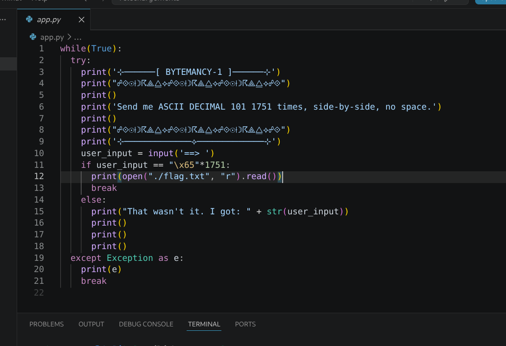

> Un challenge court mais qui teste un réflexe précis : savoir manipuler des **codes ASCII** et automatiser l'envoi de données vers un service réseau avec `netcat`. Le service distant pose une seule question, formulée volontairement de façon un peu piégeuse — à nous de bien la décoder avant de répondre.

## 🎯 En bref

| Infos | Détails |
| ----- | ------- |
| **Catégorie** | General Skills |
| **Difficulté** | 🟢 Facile |
| **Plateforme** | picoCTF 2026 |
| **Auteur du challenge** | LT 'syreal' Jones |
| **Outils utilisés** | `netcat` (`nc`), Python 3 (`chr`/répétition de chaîne) |
| **Connexion** | `nc foggy-cliff.picoctf.net 59581` |

## 📜 Énoncé

> Can you conjure the right bytes? The program's source code can be downloaded here.
>
> Connect to the program with netcat: `nc foggy-cliff.picoctf.net 59581`
>
> **Hint :** No copy-pasta, please - use Python!

_Le challenge sur la plateforme picoCTF_

L'indice est explicite : pas question de copier-coller une chaîne de 1751 caractères à la main, il faut la **générer avec Python**. En se connectant au service, celui-ci affiche sa demande :

```
⊹──────[ BYTEMANCY-1 ]──────⊹
☍⟐☉⟊☽☈⟁⧋⟡☍⟐☉⟊☽☈⟁⧋⟡☍⟐☉⟊☽☈⟁⧋⟡☍⟐

Send me ASCII DECIMAL 101 1751 times, side-by-side, no space.

☍⟐☉⟊☽☈⟁⧋⟡☍⟐☉⟊☽☈⟁⧋⟡☍⟐☉⟊☽☈⟁⧋⟡☍⟐
⊹─────────────⟡─────────────⊹
==>
```

## 🔍 Découvertes

### Étape 1 — Analyser le code source fourni (`app.py`)

Comme l'énoncé le précise, le code source du programme est téléchargeable. C'est la première chose à consulter — pas besoin de deviner la logique du challenge, elle est écrite noir sur blanc :

```python
while(True):
  try:
    print('⊹──────[ BYTEMANCY-1 ]──────⊹')
    print("☍⟐☉⟊☽☈⟁⧋⟡☍⟐☉⟊☽☈⟁⧋⟡☍⟐☉⟊☽☈⟁⧋⟡☍⟐")
    print()
    print('Send me ASCII DECIMAL 101 1751 times, side-by-side, no space.')
    print()
    print("☍⟐☉⟊☽☈⟁⧋⟡☍⟐☉⟊☽☈⟁⧋⟡☍⟐☉⟊☽☈⟁⧋⟡☍⟐")
    print('⊹─────────────⟡─────────────⊹')
    user_input = input('==> ')
    if user_input == "\x65"*1751:
      print(open("./flag.txt", "r").read())
      break
    else:
      print("That wasn't it. I got: " + str(user_input))
      print()
      print()
      print()
  except Exception as e:
    print(e)
    break
```

La ligne clé est celle-ci :

```python
if user_input == "\x65"*1751:
```

`\x65` est une **séquence d'échappement** : à l'intérieur d'une chaîne Python, elle représente le caractère dont le code hexadécimal vaut `0x65`. Converti en décimal, `0x65` correspond exactement à **101** — le nombre mentionné dans le message affiché par le programme. Le caractère ASCII n°101 est la lettre minuscule **`e`**. Le script attend donc que `user_input` soit **exactement** égal à la lettre `e` répétée 1751 fois, sans aucun espace ni caractère supplémentaire — la moindre différence (espace, retour à la ligne, caractère en trop) fait échouer la comparaison.


_Le fichier `app.py` fourni avec le challenge, ouvert dans VS Code_

### Étape 2 — Bien relire la consigne affichée (le piège de vocabulaire)

Le service demande : *"Send me ASCII DECIMAL 101 1751 times, side-by-side, no space."* Le piège classique ici serait de comprendre "envoie-moi le texte `101`, répété 1751 fois" — **ce n'est pas ce qui est demandé**. `101` est un **code ASCII décimal**, c'est-à-dire le numéro qui identifie un caractère dans la table ASCII. Ce qu'il faut envoyer, c'est **le caractère correspondant à ce code**, répété 1751 fois — ce que le code source confirme d'ailleurs très précisément.

En consultant une table ASCII (ou avec `chr(101)` en Python), le caractère n°101 est la lettre minuscule **`e`**. La consigne demande donc, en clair : *"envoie-moi la lettre `e` répétée 1751 fois, collée sans espace"*.

### Étape 3 — Première tentative ratée (comprendre pourquoi)

Premier réflexe naturel : taper directement une commande Python **dans le prompt du challenge**, en espérant qu'elle soit exécutée côté serveur :

```
==> python3 -c 'c = "\x65" ; print(c*1751)'
That wasn't it. I got: python3 -c 'c = "\x65" ; print(c*1751)'
```

Le service répond en citant exactement ce qui a été tapé — la leçon est claire : **le serveur ne fait qu'attendre du texte brut en entrée**, il n'exécute aucune commande. La chaîne `python3 -c '...'` a été reçue **telle quelle**, comme une suite de caractères parmi d'autres, pas comme une instruction à interpréter. Il faut donc **générer la réponse avant de l'envoyer**, pas espérer que le serveur la génère à notre place.

### Étape 4 — Générer la chaîne côté client puis l'envoyer

La bonne méthode : exécuter la commande Python **sur sa propre machine**, récupérer la chaîne de 1751 `e`, puis la coller dans le prompt `==>` du service :

```bash
python3 -c "print('e'*1751)"
```

En collant le résultat obtenu :

```
==> eeeeeeeeeeeeee[...]eeeeeeeeeeeeeee
picoCTF{h0w_m4ny_e's???_7dbc095c}
```

🏁 **Flag obtenu : `picoCTF{h0w_m4ny_e's???_7dbc095c}`**

### Étape 5 — Automatiser (aller plus vite avec un pipe)

Copier-coller manuellement une chaîne de 1751 caractères fonctionne, mais ce n'est pas très pratique — surtout si le port change à chaque connexion (comme c'est le cas ici, le service redonne un nouveau port en cas de relance). On peut directement **chaîner la génération et l'envoi réseau** avec un pipe (`|`), qui redirige la sortie d'une commande vers l'entrée d'une autre :

```bash
python3 -c 'c = "\x65" ; print(c*1751)' | nc foggy-cliff.picoctf.net 59581
```

Résultat :

```
⊹──────[ BYTEMANCY-1 ]──────⊹
...
Send me ASCII DECIMAL 101 1751 times, side-by-side, no space.
...
==> picoCTF{h0w_m4ny_e's???_7dbc095c}
```

En une seule ligne : Python génère la chaîne de 1751 `e`, et `nc` l'envoie automatiquement au service dès la connexion établie — plus besoin de copier-coller à la main.

## ⚠️ Petit aparté : le piège du script `.py` mal utilisé

Une tentative intermédiaire a échoué pour une raison différente :

```bash
┌──(emma_aura㉿kali)-[~/Téléchargements]
└─$ python3 solve.py nc foggy-cliff.picoctf.net 59581
  File "/home/emma_aura/Téléchargements/solve.py", line 1
    'c = "\x65" ; print(c*1751)'
IndentationError: unexpected indent
```

Le fichier `solve.py` avait été créé avec `nano` en collant uniquement le morceau de commande `'c = "\x65" ; print(c*1751)'` — soit un fragment invalide en tant que **fichier** Python (les guillemets simples autour de tout le bloc n'ont de sens que dans le contexte `python3 -c '...'`, pas à l'intérieur d'un fichier `.py`). C'est un bon rappel de la différence entre :
- `python3 -c "code"` → le code est passé en argument, entre guillemets gérés par le shell
- `python3 fichier.py` → le fichier ne doit contenir **que** du code Python valide, sans les guillemets englobants ajoutés pour `-c`

## 🛠️ Commandes clés

| Commande | Rôle |
| -------- | ---- |
| `chr(101)` (Python) | Convertir un code ASCII décimal en son caractère correspondant |
| `python3 -c "print('e'*1751)"` | Générer une chaîne de 1751 caractères `e` collés |
| `commande \| nc host port` | Envoyer directement la sortie d'une commande vers un service réseau |

## 🧠 Ce que je retiens

- Toujours bien distinguer un **code ASCII décimal** (un nombre, ex. `101`) du **caractère** qu'il représente (ex. `e`) — c'est une confusion fréquente dans les énoncés volontairement ambigus.
- Un service accessible via `nc` n'exécute jamais de commandes tapées dans son prompt : il ne reçoit que du **texte brut**. Toute génération de données (répétitions, conversions, calculs) doit se faire **avant** l'envoi, côté client.
- Le pipe (`|`) est l'outil le plus efficace pour chaîner "génération de données" et "envoi réseau" en une seule ligne, sans copier-coller manuel.

---

*Prochain writeup bientôt — la suite de la progression picoCTF arrive !*
